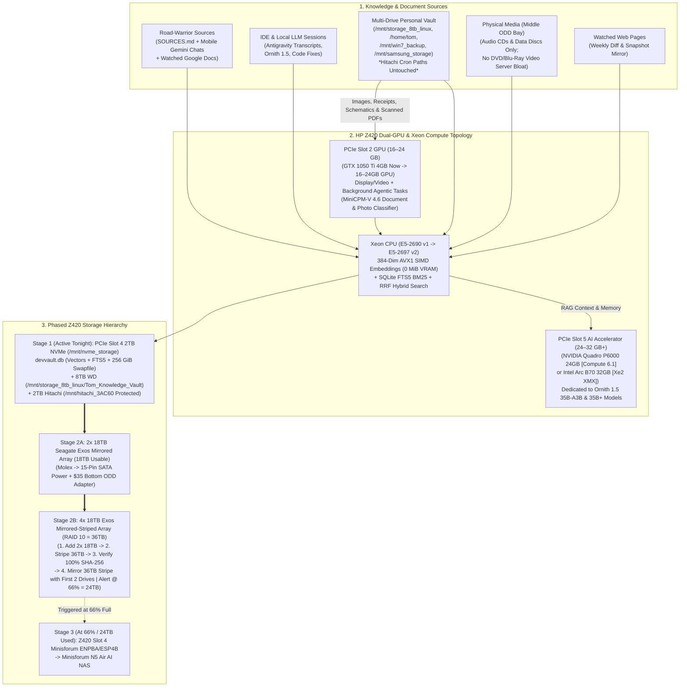

# Implementation Plan: DevVault v2.0 — Local-First Coding, Personal Document & Road-Warrior Knowledge Base (HP Z420 Workstation)

## 1. Executive Summary & Architectural Goals

We are building **DevVault v2.0** in [`/mnt/nvme_storage/ai_projects/Local knowledge base.`](file:///mnt/nvme_storage/ai_projects/Local%20knowledge%20base.) (symlinked to `/mnt/nvme_storage/devvault`), a lightweight, native **C++17** local-first knowledge base, RAG server, and autonomous overnight document & vision organizer tailored to **Owner: Tom** and the **HP Z420 Workstation**.

### Key Architectural Principles (Z420 Hardware-First Rules)
1. **CPU-Matched Native C++17 Executable (`Sandy Bridge` Today $\rightarrow$ `Ivy Bridge` Upgrade Ready):**
   - **Current CPU:** Intel Xeon **E5-2690 v1** (8 cores / 16 threads, **Sandy Bridge** `family 6, model 45`, `AVX 1.0` + `SSE4.2`, `64 GB` DDR3 ECC RAM). Compiled with `make sandybridge` (`-std=c++17 -O3 -s -march=sandybridge -mavx -msse4.2 -mno-avx2 -mno-fma -mno-f16c -pthread -ldl`).
   - **Planned CPU Upgrade:** Intel Xeon **E5-2697 v2** (12 cores / 24 threads, **Ivy Bridge**). Includes a dedicated `make ivybridge` target (`-march=ivybridge -mf16c`) ready the moment the 12-core CPU is installed.
2. **Dual-GPU Final Architecture (PCIe Slot 2 Video/Agentic GPU + PCIe Slot 5 Dedicated 35B+ AI Accelerator):**
   - **PCIe Slot 2 (`16 GB – 24 GB` GPU — Video Output + Background Agentic Tasks):**
     - Currently hosts the **GTX 1050 Ti (4GB, Compute `6.1`)** during Stage 1 baseline; upgrades to a **`16 GB – 24 GB` GPU** dedicated to desktop video output and small background agentic tasks (`MiniCPM-V 4.6` document & photo classification, OCR, and background vault indexing).
     - Because Slot 2 handles Xorg/display and `MiniCPM-V 4.6`, **background document classification runs concurrently at `~0.20–0.45s/doc` without touching a single MiB of VRAM or compute on the primary Slot 5 AI Accelerator!**
   - **PCIe Slot 5 (`24 GB – 32 GB+` GPU — Dedicated Primary 35B+ AI Accelerator):**
     - Dedicated 100% to **`Ornith 1.5 35B-A3B`** and larger `35B+` models with **zero Xorg/display VRAM overhead**.
     - **Target Candidates:**
       - **Candidate A — NVIDIA Quadro P6000 (`24 GB GDDR5X`, `384-bit`, `432 GB/s`, `3,840` CUDA cores, Pascal `GP102` Compute `6.1`):** Uses the **exact same `sm_61` (Compute `6.1`) compiler target** already optimized in `PolyStrata` for the GTX 1050 Ti—requiring **zero compiler/kernel changes** while delivering `6×` the VRAM (`24 GB` vs `4 GB`) and `3.85×` the memory bandwidth (`432 GB/s` vs `112 GB/s`), and working out-of-the-box on the stock Z420 BIOS without needing ReBAR!
       - **Candidate B — Intel Arc B70 (`32 GB GDDR6`, Battlemage `Xe2` XMX AI Engines):** Delivers **`32 GB` VRAM** for full-resident `35B+` models and deep 32K KV caches (paired with the Z420 Above-4G / ReBAR BIOS mod from Row 4 of the PolyStrata Eval Tracker).
3. **Zero-VRAM Text Embedding + Proven `MiniCPM-V 4.6` Vision Classification ([`src/vision_minicpm.hpp`](file:///mnt/nvme_storage/ai_projects/Local%20knowledge%20base./src/vision_minicpm.hpp)):**
   - **Text & Code Embeddings (`0 MiB` VRAM):** Runs 100% on the Xeon CPU via 256-bit Sandy Bridge `AVX 1.0` SIMD instructions ([`src/embed_avx.hpp`](file:///mnt/nvme_storage/ai_projects/Local%20knowledge%20base./src/embed_avx.hpp)).
   - **Document & Image Classification via `MiniCPM-V 4.6`:**
     - Uses the proven **GTX 1050 Ti (`448px` single-patch, `~3,013 MiB` VRAM, `~820ms` vision encode)** profile from your Photo Sorter today, and automatically pins to the **Slot 2 GPU (`1344px` multi-patch 100% VRAM residency)** when the dual-GPU topology is installed.
4. **2TB NVMe (`/mnt/nvme_storage`) for Vectors + Active `256 GiB` Swapfile:**
   - The PCIe Slot 4 2TB HP EX950 NVMe hosts both the active **`256 GiB` `/mnt/nvme_storage/swapfile`** and `/mnt/nvme_storage/devvault/devvault.db` (SQLite WAL + FTS5 BM25 + 384-dim `float32` vector index).
5. **2TB Hitachi (`/mnt/hitachi_3AC60`) Protected & 8TB WD (`/mnt/storage_8tb_linux`) Active Vault:**
   - `/mnt/hitachi_3AC60/staging_cache` and `/mnt/hitachi_3AC60/system_snapshots` remain **100% untouched in place** so existing cron jobs and the 2 SATA SSD backups continue uninterrupted until the Exos array + `/etc/fstab` bind mounts are active.



---

## 2. HP Z420 Dual-GPU PCIe Topology & `MiniCPM-V 4.6` Scaling (Slot 2 Agentic GPU + Slot 5 35B+ AI Accelerator)

### 2.1 Complete HP Z420 PCIe Slot Assignment Map

| HP Z420 PCIe Slot | Electrical Bus | Current Baseline Hardware | Final Target Configuration | Dedicated Operational Role |
| :--- | :--- | :--- | :--- | :--- |
| **PCIe Slot 2** | **PCIe 3.0 x16** *(CPU Direct)* | **NVIDIA GTX 1050 Ti (4 GB)** *(Pascal `GP107`, Compute `6.1`)* | **`16 GB – 24 GB` GPU** | **Video Output (Xorg) + Small Background Agentic Tasks:** Runs `MiniCPM-V 4.6` document/photo classification (`~5.5 GB` VRAM at `1344px` 100% VRAM residency), OCR, and background agents with zero impact on Slot 5. |
| **PCIe Slot 4** | **PCIe 3.0 x8** *(CPU Direct)* | **2TB HP EX950 M.2 NVMe** (`/mnt/nvme_storage`) | **2TB NVMe** $\rightarrow$ *Stage 3: **Minisforum ENPBA / ESP4B*** | Hosts `devvault.db` (hot SQLite WAL + FTS5 + 384-dim AVX1 vectors) and the `256 GiB` NVMe swapfile; bridges to the Minisforum N5 Air AI NAS at Stage 3. |
| **PCIe Slot 5** | **PCIe 3.0 x16** *(CPU Direct)* | *Open (Prepared for Primary AI Accelerator)* | **`24 GB` or `32 GB+` AI Accelerator** *(**NVIDIA Quadro P6000 24GB** `[Compute 6.1]` or **Intel Arc B70 32GB**)* | **Dedicated Primary 35B+ AI Accelerator:** Runs **`Ornith 1.5 35B-A3B`** and larger `35B+` models with **0 MiB display overhead** and full dedicated memory bandwidth. |

### 2.2 Engineering Comparison for PCIe Slot 5 (`35B+` Primary AI Accelerator): **NVIDIA Quadro P6000 (24GB)** vs. **Intel Arc B70 (32GB)**

| Feature / Metric | **Candidate A: NVIDIA Quadro P6000 (24 GB)** | **Candidate B: Intel Arc B70 (32 GB)** |
| :--- | :--- | :--- |
| **Architecture & Compute** | **NVIDIA Pascal `GP102` — Compute Capability `6.1` (`sm_61`)** (`3,840` CUDA Cores) | **Intel Battlemage `Xe2` (`BMG-G31`)** (`XMX` Systolic Matrix Engines) |
| **VRAM & Bandwidth** | **`24 GB` GDDR5X** (`384-bit` bus, **`432 GB/s`** bandwidth — `3.85×` faster than 1050 Ti) | **`32 GB` GDDR6** (`256-bit` bus, `~512+ GB/s` bandwidth) |
| **Compiler & PolyStrata Compatibility** | **100% Drop-In (`-arch=sm_61`):** Uses the **exact same Compute `6.1` compiler target** already built and tuned for your GTX 1050 Ti! Zero CUDA re-architecture required. | Requires **Intel oneAPI / SYCL / Vulkan / IPEX-LLM** backend build alongside CUDA. |
| **HP Z420 BIOS Requirement** | **Works on Stock Z420 BIOS:** NVIDIA CUDA does not require Resizable BAR (ReBAR) on the Z420. | **Requires ReBAR + Above-4G Modded BIOS** (*Row 4 of Z420 PolyStrata Eval Tracker*) for full host-to-VRAM transfer speed. |
| **`Ornith 1.5 35B-A3B` Impact** | Holds base weights + `32K` KV cache + hot MoE expert cache in **`24 GB` VRAM** with `0 MiB` Xorg tax (since display is on Slot 2). | Holds **`32 GB`** of `35B+` weights/experts in VRAM, giving an extra `+8 GB` headroom for even larger `35B–70B` models or higher quants. |

### 2.3 Proven `MiniCPM-V 4.6` Vision Document & Image Classification Scaling (Slot 2 GPU)

From your tested Photo Sorter ([`classifier.py`](file:///mnt/storage_8tb_linux/python_projects/phone-photo-sorter/classifier.py), [`HARDWARE_GUIDE.md`](file:///mnt/storage_8tb_linux/python_projects/phone-photo-sorter/HARDWARE_GUIDE.md), and [`synopsis.md`](file:///mnt/nvme_storage/ai_projects/image_sorter/synopsis.md)) benchmarks on the Z420:

| Slot 2 GPU Stage | GPU & Compute | VRAM Residency | Image / PDF Scale (`max_dimension`) | Context & Threads | Vision Encode Time | End-to-End Speed (per doc/photo) |
| :--- | :--- | :--- | :--- | :--- | :--- | :--- |
| **Stage 1 Baseline (Now)** | **Slot 2: GTX 1050 Ti (4 GB GDDR5)** *(Pascal Compute `6.1`, 112 GB/s)* | **`3,013 MiB / 4,096 MiB`** *(~31% GPU layers + DDR3 hybrid)* | **`448 px` Single Visual Patch** *(JPEG q=80 in `/dev/shm`)* | `num_ctx: 768`, `num_predict: 96`, `8 threads` | **`~820 ms`** *(down from 18.5s)* | **`~8.0 – 10.5 s`** |
| **Final Dual-GPU Slot 2** | **Slot 2: `16 GB – 24 GB` Agentic/Video GPU** *(while Slot 5 runs 35B+ AI)* | **100% in Slot 2 VRAM** *(~5.5 GB used, 10–18 GB free; **0% load on Slot 5**)* | **`1344 px` High-Res Document OCR** | `num_ctx: 4096`, `num_predict: 384`, `12 threads` (`main_gpu: 0`) | **`~40 – 90 ms`** | **`~0.20 – 0.45 s` (20x–40x speedup)** |

### How [`src/vision_minicpm.hpp`](file:///mnt/nvme_storage/ai_projects/Local%20knowledge%20base./src/vision_minicpm.hpp) Implements Dual-GPU Routing & `MiniCPM-V 4.6`:
1. **Automatic Dual-GPU Role Discovery ([`MiniCpmVision::detect_hardware_profile()`](file:///mnt/nvme_storage/ai_projects/Local%20knowledge%20base./src/vision_minicpm.hpp#L95-L195)):**
   - Queries `nvidia-smi` and PCIe/DRM devices to detect whether 1 or 2 GPUs are installed.
   - When 2 GPUs are present (Slot 2 `16–24GB` + Slot 5 `24–32GB+`), it automatically pins `MiniCPM-V 4.6` (`main_gpu` / `DEVVAULT_AGENT_GPU`) to the **Slot 2 Video/Agentic GPU** so **Slot 5** remains 100% isolated for `Ornith 1.5 35B-A3B` and larger `35B+` models.
2. **RAM-Disk Single-Patch Preprocessing (`/dev/shm`, Zero SSD Wear):**
   - Renders scanned PDFs (`pdftoppm -jpeg -scale-to 448`) and scales photos/receipts/schematics in `/dev/shm` (`448px` on the GTX 1050 Ti today; automatically `1344px` once the Slot 2 `16–24GB` GPU is installed).

---

## 3. HP Z420 Physical Bay Map, 4×18TB Exos RAID Architecture & Phased Storage Roadmap

> [!CAUTION]
> **CRITICAL HARDWARE NOTE FOR MICRO CENTER (Seagate Exos 18TB Power Wiring):**
> 1. **Why Molex Solves the 3.3V Pin 3 (`PWDIS`) Issue Automatically:**
>    Enterprise Seagate Exos 18TB SATA drives implement the SATA 3.3 **Power Disable (`PWDIS`)** feature on **Pin 3 (`+3.3V` orange wire)** of the 15-pin SATA power connector. Because the Z420's **large 4-pin Molex (LP4)** peripheral cable only carries `+12V` (yellow), `Ground` (black $\times 2$), and `+5V` (red)—and **has NO `+3.3V` wire at all**—using a **4-Pin Molex to 15-Pin SATA Power Adapter** automatically leaves Pin 3 unpowered (`0V`). The Exos 18TB spins up immediately with **no firmware/BIOS flashing and no Kapton tape required**.
> 2. **Connector Warning — Do NOT Plug Power into the Small 4-Pin Header on the Exos:**
>    That small 4-pin header next to the SATA ports on the Exos is a factory diagnostic/jumper block (`TX`/`RX` serial), **NOT** a power connector. Always power the Exos through its wide **15-pin flat SATA power connector** using a **4-Pin Molex (LP4 Male) to 15-Pin SATA Power (Female) Adapter** (such as StarTech `PYO4SATA` with crimped connectors).

### Engineering Comparison: 4 × 18TB Seagate Exos Configuration (`RAID 10 Mirrored-Striped` vs. `4-Disk RAID 5` vs. `RAID 6 / RAIDZ2`)

| Metric | **Recommended: Mirrored 36 TB Striped Array (`RAID 10` / ZFS Striped Mirrors)** | **4-Disk RAID 5 / RAIDZ1** | **4-Disk RAID 6 / RAIDZ2** |
| :--- | :--- | :--- | :--- |
| **Usable Capacity** | **`36 TB`** *(~40+ TB effective with `lz4` compression)* | `54 TB` | `36 TB` |
| **Zero-Risk Staged Migration Path (2 Drives $\rightarrow$ 4 Drives)** | **100% Verified Before Re-Purposing Primary Drives:** Keep your initial **18 TB Mirror (`Exos #1 + #2`)** intact while building and striping across the new **`36 TB` Striped Volume (`Exos #3 + #4`)**; verify every file's `SHA-256` checksum on the 36 TB stripe first; only then attach `Exos #1 + #2` to mirror the 36 TB stripe! | **High-Risk Reshape:** Cannot verify a separate 36 TB striped copy while keeping the 2-drive mirror intact. | **Requires All 4 Drives Up Front:** Cannot stage 2 drives as an intact mirror while testing the other 2 drives as a stripe. |
| **Rebuild Stress if 1 Drive Fails** | **Low & Fast (~18 hours):** Only reads `18 TB` sequentially from the 1 surviving mirror partner (`260 MB/s`); zero parity math and zero load on the other 2 drives. | **EXTREME RISK (~30–40 hours):** Must read **every sector of all 3 surviving drives (`54 TB` total read)**. A single URE or 2nd drive hiccup **destroys all 54 TB**. | **Moderate (~28 hours):** Reads `54 TB` across 3 drives, with 1 parity drive of safety margin. |
| **Sustained Read / Write Speed** | **`~1,000 MB/s` Read / `~520 MB/s` Write** (2× write IOPS, 4× read IOPS) | `~750 MB/s` Read / Slower random writes | `~500 MB/s` Read / Slower random writes |

### HP Z420 Chassis Bay Layout & Front Intake Airflow Map (4 × 3.5" HDD Bays Total)

| Z420 Physical Bay | Stage 1.5 / Stage 2A (2× 18TB Exos Mirror) | Stage 2B (Full 4× 18TB Exos Mirrored-Striped Array = 36TB) | Thermal & Operational Role |
| :--- | :--- | :--- | :--- |
| **Top 5.25" Optical Bay** | **Dual 2.5" SATA SSD Carrier** (`/dev/sda` OS + `/dev/sdb` 500GB Samsung) | **Dual 2.5" SATA SSD Carrier** (`/dev/sda` OS + `/dev/sdb` 500GB Samsung) | **Keep in place.** Preserves front intake airflow pulled through the upper lift-handle / 2.5" cage. |
| **Middle 5.25" Optical Bay** | **DVD Optical Drive** | **DVD Optical Drive** | **Keep in place.** Used for **Audio CDs** and **physical data discs** (no video server bloat). |
| **Bottom 5.25" Optical Bay** | **`$35` HP `683870-001` Carrier: Exos #2 (18TB)** | **`$35` HP `683870-001` Carrier: Exos #4 (18TB)** | Replaces blank faceplate to provide **3.5" HDD Bay #4**. |
| **Internal 3.5" Bay 1** | **8TB WD HDD** (`/mnt/storage_8tb_linux` + `/mnt/win7_backup`) | **Exos #3 (18TB)** *(8TB WD data migrated onto Exos pool)* | New 36TB Stripe Member A (`Exos #3`), later mirrored by `Exos #1`. |
| **Internal 3.5" Bay 2** | **2TB Hitachi HDD** (`/mnt/hitachi_3AC60` cron/SSD backups) | **Exos #2 (18TB)** *(`/mnt/hitachi_3AC60` bind-mounted on Exos pool)* | Initial 18TB Mirror Drive B $\rightarrow$ becomes Mirror Partner for `Exos #4`. |
| **Internal 3.5" Bay 3** | **Exos #1 (18TB)** *(Already in case)* | **Exos #1 (18TB)** | Initial 18TB Mirror Drive A $\rightarrow$ becomes Mirror Partner for `Exos #3`. |
| **PCIe Slot 4 (Gen3 x8)** | **2TB HP EX950 M.2 NVMe** (`/mnt/nvme_storage`) | **2TB HP EX950 M.2 NVMe** $\rightarrow$ *Stage 3: Minisforum ENPBA / ESP4B* | Hosts hot SQLite WAL + FTS5 + Vector DB (`devvault.db`) & `256 GiB` Swapfile. |

---

### Phased Storage Execution Stages

#### Stage 1 (Immediate): Prove Concept on Installed NVMe + 8TB WD HDD (Hitachi Migration PAUSED)
1. **Hot Vector & FTS5 Database + 256GB Swap on Installed 2TB NVMe (`/mnt/nvme_storage`, `1.3 TB` free):**
   - Hosts `/mnt/nvme_storage/devvault/devvault.db` and the active `256 GiB` `/mnt/nvme_storage/swapfile`.
2. **Categorized Vault on Installed 8TB WD HDD (`/mnt/storage_8tb_linux`, `4.6 TB` free):**
   - Hosts `/mnt/storage_8tb_linux/Tom_Knowledge_Vault/<Category>/` while we prove the concept, test, and debug.
3. **2TB Hitachi (`/mnt/hitachi_3AC60`) — Migration PAUSED:**
   - `/mnt/hitachi_3AC60/staging_cache` and `/mnt/hitachi_3AC60/system_snapshots` remain 100% untouched in place so cron jobs and the 2 SATA SSD backups continue without interruption.

#### Stage 2A: Initial 18 TB Mirrored Array (`Exos #1 + Exos #2 = 18 TB Usable`, Alongside 8TB WD & 2TB Hitachi)
1. Spin up **Exos #1** (in Internal Bay 3) using the Micro Center 4-pin Molex $\rightarrow$ 15-pin SATA power adapter.
2. When the **`$35` HP `683870-001` carrier** arrives for the **Bottom Optical Bay (Bay #4)**, install **Exos #2** and build the **18 TB Mirrored Array (`RAID 1` across `Exos #1 + Exos #2`)** at `/mnt/exos_mirror` — without having to remove the 8TB WD or 2TB Hitachi yet.
3. Evacuate the 2TB Hitachi (`188 GB`) and 8TB WD (`1.08 TB`) onto the **18 TB Mirrored Array (`Exos #1 + Exos #2`)**, verify `SHA-256` checksums, and set up `/etc/fstab` **bind mounts** so `/mnt/hitachi_3AC60`, `/mnt/storage_8tb_linux`, and `/mnt/win7_backup` continue resolving at their exact original paths for all cron jobs.
4. **Stage 2A Capacity Trigger (`66%` of `18 TB` = `12.0 TB`):** `devvault storage-guard` monitors the 18 TB mirror and warns at **`12.0 TB` (`66%`)**.

#### Stage 2B: Verified 4-Step Transition to 36 TB Mirrored-Striped Array (`4 × 18TB Exos = 36 TB Usable`)
1. **Step 1 — Bring Two More 18 TB Exos (`Exos #3 + Exos #4`) Online:**
   - Install **Exos #3 and Exos #4** into the two freed internal 3.5" bays (while **Exos #1 and Exos #2** remain untouched holding your complete 18 TB mirrored data).
2. **Step 2 — Stripe Data Across the Newly Installed Dual 18 TB Exos (`36 TB Striped Volume`):**
   - Configure **Exos #3 + Exos #4** as a **36 TB Striped Array** and stream all data from the primary 18 TB mirror across the new 36 TB striped volume at full sequential speed (`~520 MB/s` write).
3. **Step 3 — Full Accuracy & Checksum Verification of the 36 TB Striped Array (`devvault verify-array`):**
   - Before touching `Exos #1` or `Exos #2`, run `devvault verify-array --source /mnt/exos_mirror --target /mnt/exos_36tb_stripe` to verify 100% of file counts, byte sizes, and cryptographic `SHA-256` hashes.
4. **Step 4 — Build the Mirrored-Striped Array from the First Two Drives (`Exos #1 + Exos #2`):**
   - Only after Step 3 reports **0 errors and 100% hash match**, attach `Exos #1` and `Exos #2` as the **mirror partners** of `Exos #3` and `Exos #4` (`RAID 10`).
5. **Stage 2B Capacity Trigger (`66%` of `36 TB` = `24.0 TB`):** When the 36 TB Mirrored-Striped Array reaches **`24.0 TB` (`66%`)**, `devvault storage-guard` triggers the **Stage 3 External AI NAS Alert**.

#### Stage 3 (Post-24TB Scale-Out): External AI NAS & Z420 Slot 4 PCIe Expansion
1. **Z420 Slot 4 Host Adapter:** **[MINISFORUM ENPBA PCIe Card](https://store.minisforum.com/products/minisforum-enpba)** or **[MINISFORUM ESP4B](https://store.minisforum.com/products/minisforum-esp4b-pcie-to-4-nvme-m-2-expansion-card)**.
2. **External AI NAS Target:** **[MINISFORUM N5 Air AI NAS](https://store.minisforum.com/products/minisforum-n5-air-ai-nas)** (AMD Ryzen™ 7 255, up to 96GB DDR5, 5-bay SATA + NVMe up to 174TB, 10GbE + 5GbE LAN, OCuLink).

---

## 4. Directory & Native C++17 Source Structure (Implemented in Workspace)

```text
/mnt/nvme_storage/ai_projects/Local knowledge base./   (symlinked <-> /mnt/nvme_storage/devvault)
├── Makefile                          # Targets: `make sandybridge` (E5-2690 v1) & `make ivybridge` (E5-2697 v2)
├── AGENTS.md                         # Local-First RAG rule & Sandy Bridge / Ivy Bridge build rules
├── IMPLEMENTATION_PLAN.md            # Standalone v2.0 architecture & phased storage plan
├── SOURCES.md                        # Master watchlist (Google Docs, Mobile Gemini Chats, Web Mirrors)
├── src/
│   ├── main.cpp                      # CLI router (`init-all`, `search`, `store`, `test-vision`, `night-classify`, `mcp`, etc.)
│   ├── sqlite_dl.hpp                 # Dynamic `libsqlite3.so.0` loader (zero external -dev package dependencies)
│   ├── sha256.hpp                    # Zero-dependency RFC 6234 SHA-256 file & string hasher
│   ├── scrubber.hpp                  # High-speed regex secret/API key scrubber & JSON helpers
│   ├── embed_avx.hpp                 # Sandy Bridge AVX 1.0 256-bit SIMD 384-dim vectorizer & cosine similarity (0 MiB VRAM)
│   ├── vision_minicpm.hpp            # Dual-GPU aware MiniCPM-V 4.6 (Slot 2 16-24GB Agentic GPU + Slot 5 35B+ AI)
│   ├── db.hpp                        # SQLite WAL, FTS5 BM25, Vector BLOB RRF, file_move_ledger & web_snapshots
│   ├── subsystems.hpp                # StorageGuard, DocumentClassifier, CodingSync, RoadSync & WebMirror
│   └── mcp_server.hpp                # Native stdio JSON-RPC 2.0 MCP server + HTTP gateway (:8089)
├── bin/
│   └── devvault                      # Stripped Sandy Bridge AVX1 native ELF binary (< 250 KB, < 10 MB RSS)
└── /mnt/nvme_storage/devvault/
    └── devvault.db                   # Active Vector + FTS5 SQLite database on NVMe
```

---

## 5. Verification & Execution Commands

1. **Compile for Xeon E5-2690 v1 (`Sandy Bridge` `AVX 1.0`):**
   ```bash
   make sandybridge
   ```
2. **Run Full Initial Ingestion & Verification Pass (`init-all`):**
   ```bash
   ./bin/devvault init-all
   ```
3. **Test `MiniCPM-V 4.6` Vision Document & Photo Classification (Slot 2 Agentic GPU):**
   ```bash
   ./bin/devvault test-vision <path_to_document_pdf_or_photo>
   ```
